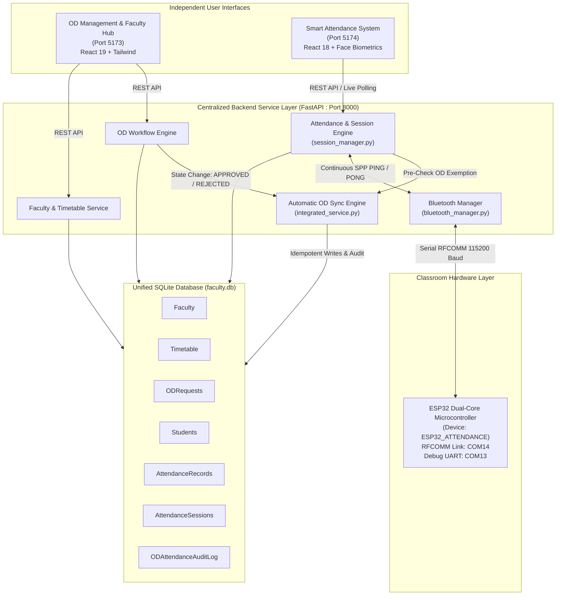

# Smart Campus Management Ecosystem: Faculty Availability & OD Management with ESP32 Bluetooth Smart Attendance System

A unified, enterprise-grade collegiate management ecosystem integrating **Faculty Availability & On-Duty (OD) Sanctioning** with an **ESP32 Bluetooth Classic SPP & Computer Vision Smart Classroom Attendance System**.

Both applications operate as independent frontends with custom user experiences while sharing a centralized backend service layer, atomic SQLite database, and real-time automated OD-to-Attendance synchronization.

---

## 1. System Architecture & Two-Application Overview

The ecosystem preserves two decoupled, specialized frontends connected through a centralized FastAPI service layer:

1. **Application 1: Faculty Availability & On-Duty (OD) Management Hub** (Vite + React 19 + Tailwind CSS)
   - Real-time faculty cabin/class availability indicator.
   - Comprehensive faculty timetable index.
   - Student OD application submission with category, reason, period selection, and proof attachments.
   - Faculty & Management OD approval/rejection queue.
   - Appointment booking portal and OCR-assisted timetable ingestion.
   - Management Dashboard with live synchronized attendance metrics and audit trails.

2. **Application 2: ESP32 Bluetooth-Based Smart Classroom Attendance System** (Vite + React 18 + Tailwind CSS)
   - Tri-factor verification: Student ID validation, OpenCV face biometric recognition, and Bluetooth beacon presence.
   - Persistent ESP32 Bluetooth Classic Serial Port Profile (SPP, RFCOMM) telemetry.
   - Automated 5-minute watchdog countdown with consecutive-miss tracking (3-strike penalty).
   - Real-time **OD – PRESENT** exemption preventing false absence penalties for officially excused students.
   - Attendance history ledger distinguishing physical presence from official duty.



---

## 2. Automatic OD-to-Attendance Workflow

```mermaid
sequenceDiagram
    autonumber
    actor Student
    actor Faculty
    participant OD_App as OD Management Frontend
    participant Backend as Centralized Backend & DB
    participant Att_App as Smart Attendance Frontend
    participant ESP32 as ESP32 Bluetooth Beacon

    Student->>OD_App: Submits OD Request (Date, Periods 1-4, Reason, Proof)
    OD_App->>Backend: POST /api/od-requests (Status: PENDING)
    Note over Backend: Request stored. Not yet counted in attendance.
    Faculty->>OD_App: Reviews and Clicks "Approve OD"
    OD_App->>Backend: PUT /api/od-requests/{id} (Status: APPROVED)
    
    rect rgb(30, 41, 59)
        Note over Backend: integrated_service.sync_approved_od_to_attendance()
        Backend->>Backend: 1. Resolves Student ID & Period Range
        Backend->>Backend: 2. Inserts AttendanceRecords as 'OD – PRESENT' (Mode: OD_EXEMPTION)
        Backend->>Backend: 3. Writes Immutable Audit Log Entry
    end

    Student->>Att_App: Verifies Face Biometrics & Enters Classroom
    Att_App->>Backend: POST /api/attendance/start
    
    rect rgb(20, 83, 45)
        Backend->>Backend: Pre-Check: check_student_od_status() -> APPROVED OD FOUND!
        Backend-->>Att_App: Returns 'OD – PRESENT' Exemption Active
    end

    loop Every 5 Minutes (Heartbeat)
        Backend->>Backend: Verifies OD Exemption Status
        Note over Backend,ESP32: Student excluded from Bluetooth absence penalty!
    end

    Att_App-->>Student: Displays 'OD – PRESENT' with Sparkling Purple Badge
```



---

## 3. Technology Stack

- **Centralized Backend**: Python 3.11, FastAPI 0.112+, Uvicorn 0.30+, SQLite3 (WAL mode), Pydantic v2.
- **Computer Vision & Hardware Drivers**: OpenCV 4.8+ (Haar Cascade biometric template matching), PySerial 3.5 (RFCOMM Bluetooth SPP).
- **Faculty Availability & OD Frontend**: React 19, Vite 8, Tailwind CSS 4, Lucide React, Recharts.
- **Smart Attendance Frontend**: React 18, Vite 6, Tailwind CSS 3, Lucide React, Canvas Confetti.
- **Embedded Firmware**: C++ (Arduino ESP32 Core 2.0+), BluetoothSerial library, GAP/SPP profile stack.

---

## 4. Repository Structure

```
od-main-final/
├── backend/
│   ├── integrated_service.py     # Centralized OD-to-Attendance synchronization & audit service
│   ├── main.py                   # Centralized FastAPI backend routes & management endpoints
│   ├── faculty.db                # Unified SQLite database (Shared between both applications)
│   ├── package.json              # Optional Node.js microservice dependencies
│   └── requirements.txt          # Python backend dependencies
│
├── attendance/
│   ├── backend_python/
│   │   ├── bluetooth_manager.py  # Robust Windows RFCOMM / SPP serial driver for COM14
│   │   ├── config.py             # Hardware & heartbeat watchdog configuration
│   │   ├── config.env            # Environment configuration
│   │   ├── database.py           # Hybrid DataStore interfacing directly with faculty.db
│   │   ├── face_engine.py        # OpenCV face signature biometric comparison engine
│   │   ├── main.py               # Attendance API endpoints & session lifecycle handlers
│   │   └── session_manager.py    # 5-minute countdown watchdog with OD Exemption logic
│   │
│   ├── frontend/
│   │   ├── src/
│   │   │   ├── App.jsx           # Attendance Portal UI with OD - PRESENT badges & telemetry
│   │   │   ├── components/       # Face verification, student input, and Bluetooth status cards
│   │   │   └── services/api.js   # Client HTTP service for attendance backend
│   │   ├── package.json
│   │   └── vite.config.js        # Configured for Port 5174 with backend proxy to Port 8000
│   │
│   ├── esp32_firmware_spp.ino    # ESP32 Bluetooth Classic SPP firmware
│   └── run_system.bat            # Windows master launcher script
│
├── src/                          # OD Management Application Frontend (React 19)
│   ├── App.jsx                   # Faculty directory, OD pass workflows, and Management Sync tab
│   ├── components/               # Animated background layers and UI components
│   └── App.css                   # Custom styles & design themes
│
├── tests/
│   └── test_integration.py       # Automated integration test suite covering 10 operational scenarios
│
├── .env.example                  # Environment variable reference template
├── package.json                  # OD Management frontend package configuration
└── README.md                     # Comprehensive system documentation
```

---

## 5. Centralized Database Schema

All institutional data resides in `backend/faculty.db`:

| Table | Purpose | Key Columns |
|---|---|---|
| `Students` | Unified student directory | `registration_number` (PK), `name`, `department`, `year`, `section`, `face_template` |
| `Faculty` | Faculty directory & status | `faculty_id` (PK), `name`, `designation`, `department`, `location`, `status_override` |
| `Timetable` | Class schedule | `timetable_id` (PK), `faculty_id`, `day`, `period_number`, `start_time`, `end_time`, `subject`, `room` |
| `ODRequests` | Student OD submissions | `id` (PK), `student_name`, `student_roll`, `event_name`, `event_date`, `periods`, `status`, `synced_to_attendance` |
| `AttendanceRecords` | Permanent attendance history | `id` (PK), `session_id`, `registration_number`, `date`, `period_number`, `status`, `attendance_mode`, `od_request_id` |
| `AttendanceSessions` | Live active session tracking | `session_id` (PK), `registration_number`, `status`, `consecutive_failures`, `od_exempted` |
| `ODAttendanceAuditLog`| Immutable compliance audit trail | `id` (PK), `od_request_id`, `action`, `registration_number`, `date`, `previous_status`, `new_status`, `timestamp` |

---

## 6. API Reference

### Centralized Backend (`http://127.0.0.1:8000`)

| Method | Endpoint | Description |
|---|---|---|
| `GET` | `/api/faculty` | Retrieve faculty directory and real-time availability |
| `GET` | `/api/od-requests` | List all submitted OD requests |
| `POST` | `/api/od-requests` | Submit a student OD request |
| `PUT` | `/api/od-requests/{id}` | Approve or reject OD request (triggers automatic synchronization) |
| `GET` | `/api/stats` | Retrieve live system KPIs (OD totals, attendance sync status) |
| `GET` | `/api/attendance/records` | Query synchronized attendance records by student or date |
| `GET` | `/api/attendance/audit-log` | Retrieve immutable OD synchronization audit trail |
| `POST` | `/api/attendance/start` | Start attendance session (verifies OD exemption first) |
| `GET` | `/api/attendance/session/current` | Poll live session watchdog countdown and warnings |
| `POST` | `/api/attendance/stop` | Conclude attendance session |
| `GET` | `/api/attendance-logs` | Retrieve formatted attendance history |
| `GET` | `/api/bluetooth/status` | Hardware COM port connectivity status |

---

## 7. Installation & Local Setup

### Prerequisites
- Python 3.11+
- Node.js 18+ and npm
- Windows 10/11 with Bluetooth support (for ESP32 hardware link)

### Step 1: Install Dependencies
```powershell
# Root frontend dependencies
npm install

# Attendance frontend dependencies
cd attendance\frontend
npm install
cd ..\..

# Python backend dependencies
pip install -r backend\requirements.txt
```

### Step 2: Initialize Database
```powershell
python -c "import sys; sys.path.append('backend'); import integrated_service; integrated_service.init_integrated_db()"
```

### Step 3: Run Automated Integration Tests
```powershell
python tests\test_integration.py
```
*Expected: 10/10 tests pass.*

---

## 8. Starting the Applications

Open three separate terminals:

### Terminal 1: Centralized Backend (FastAPI on Port 8000)
```powershell
cd attendance\backend_python
python -m uvicorn main:app --host 127.0.0.1 --port 8000 --reload
```

### Terminal 2: Faculty Availability & OD Frontend (Port 5173)
```powershell
npm run dev
```
Accessible at: **http://localhost:5173**

### Terminal 3: Smart Attendance Frontend (Port 5174)
```powershell
cd attendance\frontend
npm run dev
```
Accessible at: **http://localhost:5174**

---

## 9. Hardware Configuration & Validation (ESP32)

1. Connect your ESP32 board via USB.
2. In Arduino IDE, open `attendance/esp32_firmware_spp.ino` and upload to your board.
3. Open Windows Bluetooth Settings, pair with **`ESP32_ATTENDANCE`** (PIN: Just Works).
4. Verify the assigned virtual COM port in Device Manager (default is `COM14`).
5. Update `attendance/backend_python/config.env` if your port differs:
   ```env
   BLUETOOTH_PORT=COM14
   ```
> [!NOTE]
> When testing without the physical ESP32 board connected, approved OD students remain fully functional and are protected as **OD – PRESENT** by the software exemption layer.

---

## 10. License & Credits

- Developed for the Smart Campus Automation Initiative.
- Core maintainer: **B.Ganesh** (AIML).
